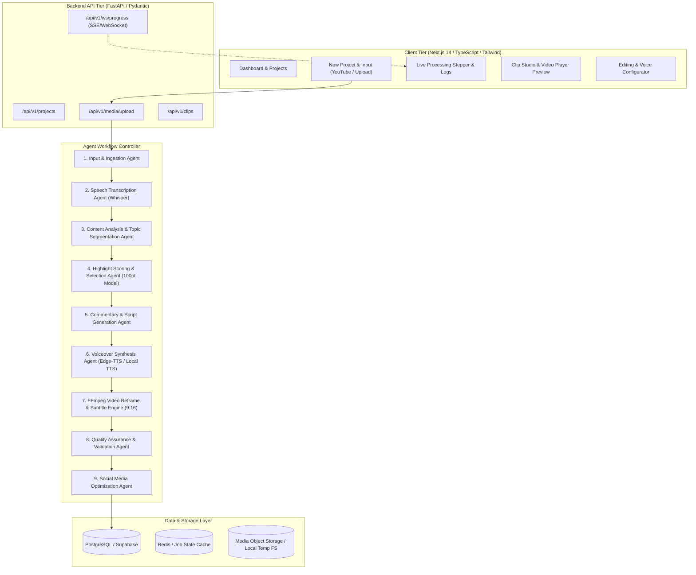

# ClipVanta — Autonomous AI Video Clipping & Production Agent
## System Architecture & Technical Specification

---

### 1. Executive Overview & Product Vision
ClipVanta is an autonomous AI video production agent designed to ingest long-form video content (via authorized upload or YouTube video metadata/transcripts), extract engaging 30–60 second highlights using multi-factor contextual scoring, generate synced AI commentary and voiceover, automatically edit and reframe into 9:16 vertical videos with burned-in animated subtitles, and produce social media publishing metadata (YouTube Shorts, Instagram Reels, TikTok).

---

### 2. Multi-Agent Pipeline Architecture

---

### 3. Core Modules & Agent Specifications

#### 3.1. Input Agent
- **Responsibilities:**
  - YouTube URL validation, metadata extraction (`title`, `duration`, `thumbnail`, `channel`), transcript verification.
  - File upload ingestion (MP4, MOV, MKV, WebM) with stream integrity checks.
  - Explicit Content Rights Confirmation tracking (must log timestamped user authorization).
  - Storage allocation and media demuxing (extracting 16kHz mono WAV for Whisper).

#### 3.2. Transcription Agent (Speech-to-Text)
- **Engine:** `faster-whisper` / `whisper-timestamped` (local, zero-cost, word-level timestamps).
- **Output:** Word-level and segment-level timestamped transcript (start ms, end ms, text, confidence).

#### 3.3. Content Analysis & Highlight Scoring Agent (100-Point Model)
Segments candidate clips (30–60s) respecting sentence boundaries. Evaluates each candidate against the strict 100-point rubric:
1. **Opening Hook (20 pts):** Grab factor in the first 3 seconds; intriguing question or strong premise.
2. **Informational Value (20 pts):** Novelty, surprising facts, deep explanation, or unique insight.
3. **Emotional Impact (15 pts):** Tension, humor, excitement, inspiration, or empathy.
4. **Storytelling Flow (15 pts):** Clear setup, build-up, and payoff within the 60s window.
5. **Standalone Context (15 pts):** Understandable without having watched the entire source video.
6. **Shareability Potential (15 pts):** Likelihood to spark debate, reposting, or sharing.

*Deductions applied for: abrupt cuts, incomplete thoughts, background noise, or low speech clarity.*

#### 3.4. Commentary & Script Generation Agent
- Generates 3-part structured commentary:
  1. **Hook:** 3–5 seconds energetic setup.
  2. **Context Explanation:** 5–10 seconds explaining why this moment is significant.
  3. **Call-to-Action / Outro:** 3–5 seconds wrap-up.
- Strict constraint: Tone matching without altering or falsifying the original speaker's intent.

#### 3.5. Voice Generation Agent
- **Default Engine:** `edge-tts` (Microsoft Neural TTS — ultra-high quality, natural intonation, 0 licensing cost, 100+ voices including Guy, Christopher, Jenny, Sonia, adjustable rate/pitch/volume).
- **Secondary / Optional:** ElevenLabs / OpenAI TTS adapter interface.

#### 3.6. Video Editing & Reframing Engine (FFmpeg & Python)
- **Target Format:** 1080 × 1920 (9:16 vertical portrait).
- **Smart Framing:**
  - Center-crop / face-tracking bounding box.
  - Blurred background stack (top & bottom blurred pillarbox) for wide content preserving full frame.
- **Subtitles:**
  - Styled ASS/SRT subtitles with bold modern typography (Montserrat/TheBoldFont).
  - Active word highlighting (karaoke style with yellow/cyan pop).
- **Audio Mixing:**
  - Audio normalization (EBU R128 standard).
  - Original speaker audio ducked dynamically under AI commentary intro/outro.

#### 3.7. Quality Assurance (QA) Agent
- Checks before final user presentation:
  - Duration constraint: 30s ≤ duration ≤ 60s.
  - Video stream validity and resolution check (`1080x1920`).
  - Audio/Video sync offset < 50ms.
  - Black frame detection (fails if > 1s continuous black frames).
  - Subtitle alignment validation.

#### 3.8. Social Media Optimization Agent
Generates per-platform metadata:
- YouTube Shorts: Title (≤ 70 chars), Description, 3–5 tags, pinned comment recommendation.
- Instagram Reels: Punchy caption, line breaks, 10 targeted hashtags, audio tag suggestion.
- TikTok: Hook title, caption (≤ 150 chars), high-retention hashtags (`#fyp`, `#shorts`, niche tags).

---

### 4. Database Schema (PostgreSQL / Supabase)

- **`projects`**:
  - `id`: UUID (PK)
  - `title`: String
  - `source_type`: Enum (`youtube`, `upload`)
  - `source_url`: String (nullable)
  - `source_path`: String (local or bucket path)
  - `duration_sec`: Float
  - `rights_confirmed`: Boolean
  - `status`: Enum (`created`, `processing`, `completed`, `failed`)
  - `error_message`: Text (nullable)
  - `created_at`: Timestamp
- **`transcripts`**:
  - `id`: UUID (PK)
  - `project_id`: UUID (FK)
  - `full_text`: Text
  - `segments_json`: JSONB (word & segment timestamps)
- **`clips`**:
  - `id`: UUID (PK)
  - `project_id`: UUID (FK)
  - `start_time`: Float
  - `end_time`: Float
  - `duration`: Float
  - `score`: Integer (0–100)
  - `score_breakdown`: JSONB
  - `title`: String
  - `commentary_script`: JSONB
  - `video_url`: String
  - `thumbnail_url`: String
  - `social_metadata`: JSONB
  - `qa_passed`: Boolean
  - `created_at`: Timestamp
